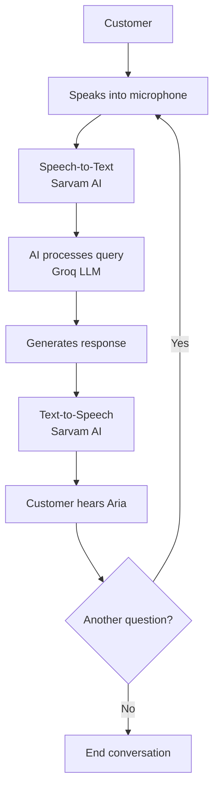

<div align="center">

# ✦ AURA
### AI-Powered Skincare Customer Support Voice Assistant

**Care that listens. Support that speaks.**

A voice-first customer support experience where customers can talk naturally with **Aria**, an AI assistant for order, delivery, return, and payment-policy questions.

[🚀 Live Application](https://skincare-product-voice-assistant.vercel.app/) · [💻 GitHub Repository](https://github.com/Jayesh1808git/Skincare-Product-Voice-Assistant)


</div>

---

## ✨ Overview

**Aura** is a full-stack, voice-enabled customer support assistant built for a skincare customer experience. Users can interact with **Aria** through a browser-based voice interface and ask common support questions conversationally.

The project brings together a React user interface, a FastAPI backend, an LLM-powered response flow, and speech services for transcription and voice generation. The frontend is deployed on Vercel, with the backend deployed separately.

> **Live demo:** [skincare-product-voice-assistant.vercel.app](https://skincare-product-voice-assistant.vercel.app/)

## 🎯 Features

- **Voice-first interaction** — speak to the assistant through the browser.
- **Speech-to-text** — transcribe recorded speech using Sarvam AI.
- **AI-generated responses** — generate conversational responses using Groq.
- **Text-to-speech** — turn assistant responses into spoken audio using Sarvam AI.
- **Customer-support scenarios** — designed for questions about orders, delivery, returns, and payment policies.
- **Language selection** — the interface includes a voice-language selector.
- **Public web deployment** — access the application online without running it locally.

*The assistant's responses depend on the backend's configured data, policies, and supported workflows. Do not assume that every external order system or live commerce platform is connected unless it is configured in the source code.*

## 🧭 How it works

1. The user opens Aura and starts a voice interaction.
2. The browser captures the user's speech.
3. The frontend sends audio to the FastAPI backend.
4. The backend calls Sarvam AI Speech-to-Text to transcribe the audio.
5. The transcript enters the assistant flow, which uses Groq to generate a response and any configured support logic.
6. The frontend displays the response and requests speech generation from Sarvam AI.
7. The generated audio is returned to the browser and played to the user.

## 🏗️ Architecture



### Main components

| Component | Responsibility |
|---|---|
| **React + Vite** | User interface, voice controls, language selection, and API requests |
| **FastAPI** | Backend API endpoints and orchestration |
| **Groq** | LLM inference for conversational responses |
| **Sarvam AI STT** | Transcribes incoming speech into text |
| **Sarvam AI TTS** | Generates speech audio from assistant text |
| **Orders and policies modules** | Provide support logic exposed by the backend |
| **Vercel** | Hosts the frontend |
| **Render** | Hosts the backend API |

##  Technology stack

| Layer | Technology | Purpose |
|---|---|---|
| Frontend | React | Interactive UI |
| Frontend tooling | Vite | Development server and production build |
| Backend | Python, FastAPI | API and assistant orchestration |
| LLM | Groq API | Generate assistant responses |
| Speech recognition | Sarvam AI | Convert user audio to text |
| Speech synthesis | Sarvam AI | Convert assistant text to audio |
| Frontend hosting | Vercel | Deploy the web application |
| Backend hosting | Render | Run the Python API |

##  Project structure

The exact repository may evolve; keep this section aligned with the actual files in GitHub.

```text
Skincare-Product-Voice-Assistant/
├── frontend/
│   ├── src/
│   │   ├── App.jsx
│   │   ├── App.css
│   │   └── ...
│   ├── public/
│   ├── package.json
│   ├── package-lock.json
│   └── vite.config.js
├── backend/
│   ├── main.py
│   ├── agent.py
│   ├── orders.py
│   ├── policies.py
│   ├── sarvam_voice.py
│   ├── requirements.txt
│   └── .env.example
├── .gitignore
└── README.md
```

##  Local setup

### Prerequisites

- Python version supported by the backend dependencies
- Node.js and npm
- A Groq API key
- A Sarvam AI API key

### 1. Clone the repository

```bash
git clone https://github.com/Jayesh1808git/Skincare-Product-Voice-Assistant.git
cd Skincare-Product-Voice-Assistant
```

### 2. Configure backend environment variables

Create `backend/.env` using `backend/.env.example` as a template:

```dotenv
GROQ_API_KEY=your_groq_api_key
GROQ_MODEL=openai/gpt-oss-120b
SARVAM_API_KEY=your_sarvam_api_key
FRONTEND_ORIGIN=http://localhost:5173
```

Never commit `.env` or real API keys to GitHub. The `.env.example` file should contain placeholders only.

### 3. Install backend dependencies

**Windows PowerShell**

```powershell
cd backend
python -m venv .venv
.\.venv\Scripts\Activate.ps1
python -m pip install --upgrade pip
pip install -r requirements.txt
```

**macOS / Linux**

```bash
cd backend
python3 -m venv .venv
source .venv/bin/activate
python -m pip install --upgrade pip
pip install -r requirements.txt
```

Start the API from the `backend/` directory:

```bash
uvicorn main:app --reload --host 127.0.0.1 --port 8000
```

If the repository uses package imports and a different entry point, use the command that matches the current source structure.

### 4. Install and start the frontend

Open a second terminal:

```bash
cd frontend
npm install
```

Create `frontend/.env`:

```dotenv
VITE_API_BASE_URL=http://127.0.0.1:8000
```

Start Vite:

```bash
npm run dev
```

Open the local URL printed by Vite, usually `http://localhost:5173`.

### 5. Try a voice conversation

1. Open the frontend in a browser.
2. Grant microphone permission when prompted.
3. Start a call and speak clearly.
4. Pause briefly while speech recognition processes the audio.
5. Listen to the assistant's spoken response.
6. If voice interaction fails, check the browser console and backend logs.

## Environment variables

### `backend/.env.example`

Commit a template with placeholder values only:

```dotenv
# Groq LLM
GROQ_API_KEY=replace_with_your_groq_api_key
GROQ_MODEL=openai/gpt-oss-120b

# Sarvam AI speech services
SARVAM_API_KEY=replace_with_your_sarvam_api_key

# Allowed frontend origin for CORS
FRONTEND_ORIGIN=http://localhost:5173
```

### `frontend/.env.example`

```dotenv
# Base URL of the FastAPI backend
VITE_API_BASE_URL=http://127.0.0.1:8000
```

For production, configure variables in the hosting dashboards:

- **Render:** `GROQ_API_KEY`, `GROQ_MODEL`, `SARVAM_API_KEY`, and `FRONTEND_ORIGIN` set to the deployed Vercel origin.
- **Vercel:** `VITE_API_BASE_URL` set to the deployed Render backend URL.

After changing a Vite environment variable in Vercel, redeploy the frontend. Never put secret API keys in variables prefixed with `VITE_`, because frontend variables can be exposed to browser users.

##  Deployment

### Frontend — Vercel

1. Import the GitHub repository into Vercel.
2. Set the root directory to `frontend`.
3. Select the Vite framework preset.
4. Set build command to `npm run build` and output directory to `dist`.
5. Add `VITE_API_BASE_URL` with the deployed backend URL.
6. Deploy.

### Backend — Render

1. Create a Render Web Service connected to the GitHub repository.
2. Set the root directory to `backend`.
3. Set the build command to `pip install -r requirements.txt`.
4. Set the start command to match the actual entry point. For a top-level `main.py`, use:

   ```bash
   uvicorn main:app --host 0.0.0.0 --port $PORT
   ```

5. Add the required backend environment variables.
6. Set `FRONTEND_ORIGIN` to the deployed Vercel origin and ensure FastAPI CORS allows it.
7. Deploy and check the service logs.

##  Validation checklist

-  The live frontend loads successfully.
-  Text chat returns a response.
-  Browser microphone permission works over HTTPS.
-  Speech-to-text returns a transcript for clear audio.
-  The assistant response is spoken through text-to-speech.
-  The configured language mode works end to end.
-  CORS allows requests from the deployed frontend.
-  Unclear speech is handled with a useful error message.
-  API keys are stored in environment variables, not committed.
-  Setup commands match the current source tree.

##  Design decisions and trade-offs

- **Separate frontend and backend deployments:** enables independent UI and API releases, but requires correct API URL and CORS configuration.
- **Hosted AI and speech APIs:** avoids hosting large models, but introduces network latency, provider dependencies, and API usage limits.
- **Separate STT and TTS stages:** keeps the voice pipeline understandable and replaceable, though waiting for each request affects responsiveness.
- **Modular support logic:** separates order and policy behavior from the conversation interface, making it easier to test and extend.

---

##  Section 9 — Tell Us How You Think

### 1. Why did you choose your particular architecture and technology stack?

I chose React for the frontend because it makes it practical to build an interactive voice interface, and FastAPI for the backend because it provides a clear API layer for coordinating the assistant, support logic, and external AI services. Groq handles language-model inference, while Sarvam AI provides speech-to-text and text-to-speech, allowing me to integrate voice capabilities without hosting those models myself. Separating the frontend and backend also makes deployment and future changes more manageable.

### 2. What was the most difficult part of the assignment, and how did you solve it?

The most challenging part was integrating the complete voice conversation flow across the browser, backend, and external AI services. Audio capture, transcription, response generation, and speech playback each have their own failure modes, so I approached the flow as separate stages, tested API requests and responses, and used backend logs to identify configuration and integration issues. This helped me get the deployed application working end to end and made failures easier to isolate.

### 3. If you had one more week to work on this, what would you improve first and why?

I would first improve reliability and observability across the voice pipeline. I would measure end-to-end response time as well as the latency of transcription, LLM generation, and speech synthesis; add more systematic error handling and automated tests; and improve the user experience when audio is unclear or a provider is unavailable. I would prioritize this before adding more features because a customer-support assistant needs to be predictable and clear, not just impressive in a successful demo.

### 4. Imagine this agent is handling 1,000 customer conversations a day. What do you think would need to change or improve?

I would start by measuring actual traffic patterns, concurrent calls, average audio duration, response latency, and provider rate limits. I would then load-test the API, use managed or autoscaling backend infrastructure, add timeouts and bounded retries for transient provider failures, and introduce structured logs, metrics, and alerts. I would also review API costs, secure and minimize retained conversation data, and add evaluation tests for response quality and policy correctness. If traffic justified it, I would consider queues for non-real-time work and caching for safe, frequently requested policy information, while keeping order-specific answers fresh. I would scale based on measured bottlenecks rather than adding infrastructure prematurely.

##  Future improvements

- **Automated tests** for API routes, policy handling, order flows, and error cases.
- **Conversation quality evaluation** to check whether responses are accurate, useful, and policy-compliant.
- **Latency monitoring** for speech recognition, LLM generation, speech synthesis, and total turn time.
- **Streaming or incremental playback** if supported by the chosen services and integration.
- **Consistent multilingual handling** so the selected language is passed through transcription, response generation, and speech synthesis.
- **Production observability** with request IDs, structured logs, provider failure metrics, and alerts.
- **Security and privacy review** for audio handling, conversation retention, rate limiting, and secret management.
- **Scalability testing** to understand concurrency, rate limits, and costs at higher usage.

##  Author

**Jayesh Gund**  
B.E. Artificial Intelligence & Machine Learning

- **Live application:** [Aura Skincare AI Voice Agent](https://skincare-product-voice-assistant.vercel.app/)
- **GitHub:** [Jayesh1808git](https://github.com/Jayesh1808git)
- **LinkedIn:** [jayesh-gund-19790b276](https://www.linkedin.com/in/jayesh-gund-19790b276/)

---

<div align="center">

**AURA · Care that listens.**

Built as an AI Voice Agent assignment for DataStraw.

</div>
